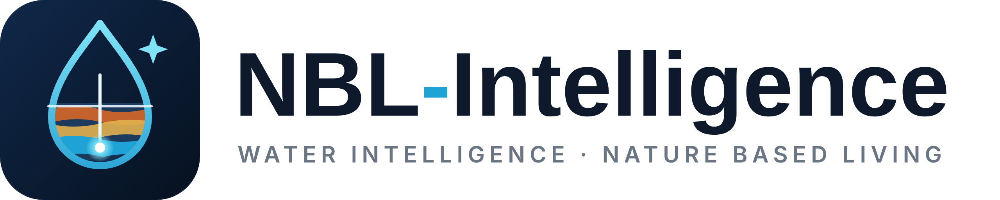

<p></p>

# NBL-Intelligence

The water intelligence platform of **Nature Based Living** (Vijayanagar Eco-Village Pvt Ltd).

NBL-Intelligence reasons with NVIDIA-hosted models and answers from two calculation engines, which stay separate programs:

| Engine | Folder | What it does |
|---|---|---|
| NBL-AquaTwin | `D:\NBL-AquaTwin` | ADMT survey interpretation, 3D model, drilling sites, recharge tiers, MODFLOW scenarios |
| NBL-WaterPlan | `D:\NBL-WaterPlan` | Daily closed-loop water balance, demand build-up, storage, treatment, tanker, net zero discharge |

Project evidence is read from the site folder (for Siddanahalli: `D:\Siddanahalli`). Nothing in the engine or project folders is ever changed by NBL-Intelligence.

## Install (once) and update (without reinstalling)

1. Download **`NBL-Intelligence_Setup_<version>.exe`** from [Releases](https://github.com/Geopromilton/NBL-Intelligence/releases/latest) and run it. No administrator rights are needed; it installs to `%LOCALAPPDATA%\Programs\NBL-Intelligence` with its own Python runtime and adds Start-menu and desktop shortcuts.
2. Open **NBL-Intelligence**. In **Settings**, paste your NVIDIA API key once (a key saved in NBL-AquaTwin is found automatically) and check the engine folders.
3. **Updates:** new versions appear as a banner and in **Settings → Updates**. *Download and install* fetches a small update package (SHA-256 checked), *Restart now* switches to it. Only the program folder is replaced; sites, runs, decisions, reports and settings live in `%LOCALAPPDATA%\NBL-Intelligence` and are never touched. The previous version is kept for *Roll back*.

The public, read-only website (GitHub Pages) shows a snapshot of the Siddanahalli results: https://geopromilton.github.io/NBL-Intelligence/

### Running from the source folder (developer copy)

The folder `D:\NBL Water Intelligence Platform` is the editable source copy, used like NBL-AquaTwin: corrections are made to its files directly. Run `NBL-Intelligence_Setup.bat` once, then `NBL-Intelligence.bat`.

### How a release is made

Every push to `main` builds and tests everything on GitHub and refreshes the website. When the number in `VERSION` is new, the build also publishes a Release (tag `vX.Y.Z`) with the installer and the update package; installed apps then offer the update. Corrections that keep the same `VERSION` are built and tested but not offered as updates.

## Pages

| Page | Purpose |
|---|---|
| Intelligence | Ask questions; the AI calls the engines, cites sources, labels every number and can suggest decisions for your approval |
| Site twin | 3D terrain, lease, drilling sites, reference borewells, recharge points, ADMT response cells and the M5 permeable-probability block for the three readings |
| Explore | Drilling sites A-G with locked predictions, reference borewells, confidence panel |
| Water plan | WaterPlan scenarios with sliders (persons per flat 2-6, flats, rain case, borewell, reservoir, RO recovery) |
| Recharge | Cloudburst storage by depth tier, RZ points, ten-year MODFLOW scenarios |
| Scenarios | Saved runs (SHA-256 fingerprint), side-by-side comparison, approve or reject |
| Integrity | Whether the registry, AquaTwin and WaterPlan hold the same numbers, with the action for each difference |
| Decisions | One decision log: NBL-Intelligence decisions and the AquaTwin log (read-only) |
| Knowledge | Search the project's own documents |
| Reports | One-click Word report in the NBL house format (Times New Roman, 600 DPI figures) |
| Settings | AI key and models, engine and project folders |

## Rules built into the product

* Every number comes from an engine run or a source document, never from the AI.
* Every number shows its provenance (measured, source document, calculated, forecast, assumption, placeholder) and its period and case (per day / per year / over the run; expected / dry / wet / design).
* One water standard: every source is filtered or RO-treated before use; no supply is ever graded "low-grade".
* Groundwater results carry the Stage A pre-drilling stamp; the three ADMT readings are kept in parallel until borehole evidence.
* AI suggestions enter the decision log only when you approve them.

## Folder layout

```
NBL-Intelligence (this folder)
  NBL-Intelligence_Setup.bat        one-time setup
  NBL-Intelligence.bat              start (desktop window)
  NBL-Intelligence_in_Browser.bat   start in the browser
  backend\nbl_intelligence\         API, engine adapters, AI core, twin, knowledge, reports, updater
  packaging\                        installer (Inno Setup), launcher, Windows build script
  view\snapshot\                    public website snapshot (scripts\export_view.py)
  .github\workflows\                GitHub builds: tests, installer, release, website
  sites\<site>\site.yaml            site registry (shared facts with sources)
  sites\<site>\twin\scene.json      prepared 3D scene
  web\                              interface (web\dist is the built client)
  state\                            runs, decisions, conversations, reports, index (created on first use)
  docs\User_Guide.md                how to use each page
  tests\                            automated tests (python -m pytest)
  _legacy_v0.1\                     the earlier v0.1 scaffold, kept for reference
```

Settings live in `%LOCALAPPDATA%\NBL-Intelligence\settings.json`, so updates never overwrite them.

## Adding a site

Create `sites\<site>\site.yaml` (copy Siddanahalli's), point `engines.aquatwin.site` and `engines.waterplan.site` to the engine site packs, add the project folder in Settings, then run `.venv\Scripts\python -m nbl_intelligence --prepare`.
